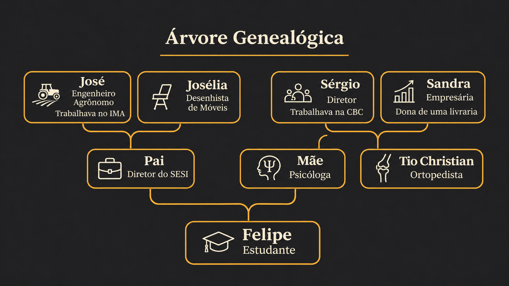

# Árvore das Profissões 2.0

Atividade 03 do portfólio de Felipe Rezende Baroncelli.

A árvore genealógica reúne as profissões e os locais de trabalho informados para minha família.

[Abrir a atividade](https://felipe-rbaroncelli.github.io/arvore-das-profissoes/)

| Pessoa | Atuação |
| --- | --- |
| José | Engenheiro agrônomo, trabalhava no IMA |
| Josélia | Desenhista de móveis |
| Sérgio | Diretor, trabalhava na CBC |
| Sandra | Empresária, dona de uma livraria |
| Pai | Diretor do SESI |
| Mãe | Psicóloga |
| Tio Christian | Ortopedista |
| Felipe | Estudante |

## Arquivos

- [arvore-genealogica.png](arvore-genealogica.png) é a imagem completa, com as informações incorporadas aos quadros.
- [index.html](index.html) exibe a imagem e permite ampliá-la.

## Processo

As informações foram fornecidas por Felipe. A criação e a edição da imagem e da página tiveram apoio de IA.

[Voltar ao portfólio](https://felipe-rbaroncelli.github.io/portfolio/#arvore-genealogica)
